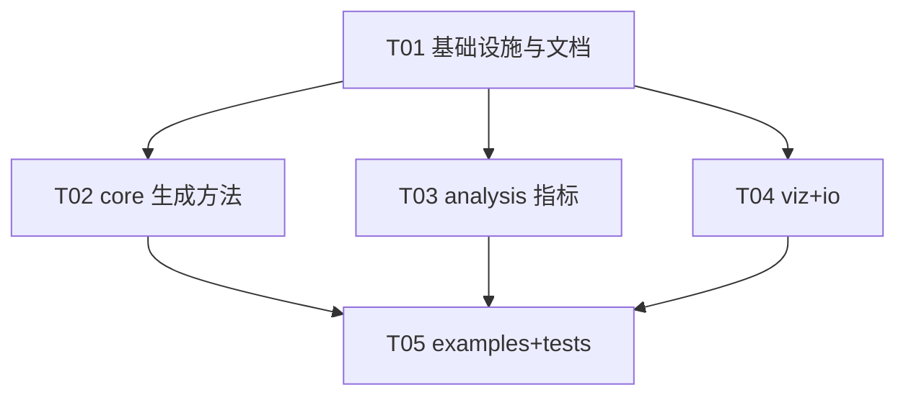

# 布朗噪声生成器（wave4）系统架构设计 + 实现任务分解

> 范围：将单文件 `wave4.py`（约 170 行）重构为规范多模块 Python 包，并基于联网检索结论做功能增强。
> 依据：原始 `wave4.py` 全部数值行为 + 检索结论（Davies–Harte / Wood–Chan、谱关系、Hurst 估计、增量方差标度）。
> 配套图：`docs/class-diagram.mermaid`、`docs/sequence-diagram.mermaid`。

---

## 1. 实现方案与框架选型

### 1.1 现状与难点

- **单文件耦合**：4 种生成算法、`matplotlib` 中文字体配置、绘图示例全部堆在 `wave4.py`，无包结构、无测试、不可扩展。
- **数值复现是硬约束**：后续 QA 会做回归测试，原有 4 法的**数值行为**和 **seeding 逻辑**（`self.rng = np.random.RandomState()`、per-call `seed` 会 `self.rng.seed(seed)` 再 `randn`）必须 1:1 保留。
- **增强需理论支撑**：新增的 Davies–Harte / Wood–Chan（circulant embedding）fBm 生成、Hurst 估计（R/S、DFA）、PSD 斜率反推 H、增量方差标度检验，都要求有可复现、可测试的数学实现，不能"表面工程"。

### 1.2 为什么这样拆（模块化依据）

| 模块 | 依据 |
|------|------|
| `core/generators.py` | 把 4 个算法 + 2 个新算法写成**纯函数**（`rng` 作为参数），与持有状态的 `BrownianNoiseGenerator` 解耦 → 独立可测、可组合、可复用。这是"真实模块化"的核心，不是搬运。 |
| `core/generator.py` | `BrownianNoiseGenerator` 退化为**薄分发器**：只负责持有 `rng`、处理 per-call `seed`、分派到纯函数。保留原公开 API。 |
| `core/_utils.py` | 抽取 `normalize()`（归一化约定唯一来源）与 fGn 自协方差 `fgng_acov()`（D-H / Hosking 共用）。 |
| `analysis/metrics.py` | 4 类指标（autocorr / PSD / Hurst / 标度）同属"质量分析"能力，纯 numpy+scipy，自洽成模块。 |
| `viz/plot.py` | 把原文件底部绘图示例迁到此处，集中管理 matplotlib 中文字体。 |
| `io/serialize.py` | 序列化为 `.npy/.npz/.csv`，仅用 numpy（csv 用 `savetxt`），零额外依赖。 |
| `examples/` | 把脚本式示例转为可运行示例，验证 API。 |
| `tests/` | 回归 + 增强覆盖。 |

### 1.3 技术选型

- **运行时**：`numpy`（向量化算法、FFT）、`scipy`（Welch PSD、DFA 多项式拟合、信号工具）、`matplotlib`（可视化）。
- **零重依赖**：除 `numpy/matplotlib/scipy/pytest` 外不引入任何第三方库（Hurst 估计全部自实现，参考 `hurst-estimators`/`hurst` 的算法而非依赖它们）。
- **包管理**：`pyproject.toml`（setuptools）+ `requirements.txt`（固定版本，便于复现）。Python ≥3.10，目标解释器 3.14。
- **架构模式**：薄分发器 + 纯函数算法层（类似 Strategy 拆分为独立可测单元）；约定优于配置（归一化/种子/字体集中管理）。

---

## 2. 文件列表及相对路径

基于 `G:/wave4` 根目录：

```
G:/wave4/
├── pyproject.toml                  # 构建/元数据/依赖（含 [test] extra）
├── requirements.txt                # 固定版本运行时依赖
├── README.md                       # 项目概览、安装、快速上手
├── CHANGELOG.md                    # 版本变更（v0.1 单文件 → v0.2 包）
├── .gitignore                      # 忽略 __pycache__、*.egg-info、build、.pytest_cache
├── wave4/                          # 包根
│   ├── __init__.py                 # 公开 API 导出 + __version__
│   ├── _config.py                  # 中文字体配置 + 版本常量
│   ├── core/
│   │   ├── __init__.py             # 导出 generators / generator
│   │   ├── _utils.py               # normalize()、fgng_acov()
│   │   ├── generators.py           # 6 个纯函数生成算法（核心）
│   │   └── generator.py            # BrownianNoiseGenerator 类（薄分发器）
│   ├── analysis/
│   │   ├── __init__.py             # 导出 metrics
│   │   └── metrics.py              # autocorr / psd / hurst / scaling
│   ├── viz/
│   │   ├── __init__.py
│   │   └── plot.py                 # 绘图（迁自原文件底部）
│   └── io/
│       ├── __init__.py
│       └── serialize.py            # save_noise / load_noise
├── examples/
│   ├── basic_usage.py              # 4 法基本用法 + seeding 复现演示
│   ├── comparison_methods.py       # 多方法对比图
│   ├── davies_harte_demo.py        # D-H fBm + Hurst 反估
│   └── analysis_demo.py            # autocorr/PSD/Hurst/标度演示
├── tests/
│   ├── conftest.py                 # sys.path 注入 + 无头 Agg 后端
│   ├── test_methods.py             # 6 法通用契约 + 方法专属数值检查
│   ├── test_analysis.py            # autocorr / PSD / Hurst / 标度
│   ├── test_errors.py              # 未知 method、beta/H 冲突、不支持的 fmt
│   ├── test_io.py                  # npy/npz/csv 往返 + metadata 前缀剥离
│   ├── test_seeding_regression.py # 与 wave4_legacy 逐点比对（回归锚点）
│   └── test_viz.py                 # Agg 后端下绘图 savefig 冒烟测试
└── docs/
    ├── system_design.md            # 本文档
    ├── class-diagram.mermaid
    ├── sequence-diagram.mermaid
    └── theory.md                   # 谱关系、D-H、Hurst 理论引用
```

---

## 3. 数据结构与接口

类图见 `docs/class-diagram.mermaid`。关键接口签名如下（全部 `float64`、1-D `(N,)`）。

### 3.1 BrownianNoiseGenerator 公开 API（保留 + 扩展）

```python
class BrownianNoiseGenerator:
    def __init__(self, method: str = 'basic') -> None
    def set_seed(self, seed: int) -> None
    def generate(self, N: int, fs: float = 1.0, intensity: float = 1.0, **kwargs) -> np.ndarray
    # 内部 _generate_* 一一对应，签名保持不变
```

- `method ∈ {'basic','freq','iir','fractal','davies_harte','hosking'}`；未知 method 抛 `ValueError`（保留原行为）。
- `generate` 的 `**kwargs` 透传给对应 `_generate_*`；**保留 per-call `seed` 行为**：若 `kwargs['seed'] is not None`，先 `self.rng.seed(seed)` 再生成。
- 各法 kwargs（默认值必须与原文件一致）：
  - `basic`：`seed`
  - `freq`：`f_min=None, f_max=None, seed`
  - `iir`：`alpha=0.99, seed`
  - `fractal`：`beta=2.0, seed`
  - `davies_harte`：`H=0.5, beta=None, seed`（二者互斥，`beta` 经 `H=(beta-1)/2` 反推，覆盖 `H`）
  - `hosking`：`H=0.5, beta=None, seed`（同上）

### 3.2 生成纯函数（`wave4.core.generators`）

```python
gen_basic(rng, N, intensity=1.0) -> np.ndarray
gen_freq(rng, N, fs=1.0, intensity=1.0, f_min=None, f_max=None) -> np.ndarray
gen_iir(rng, N, intensity=1.0, alpha=0.99) -> np.ndarray
gen_fractal(rng, N, fs=1.0, intensity=1.0, beta=2.0) -> np.ndarray
gen_davies_harte(rng, N, H=0.5, intensity=1.0) -> np.ndarray   # 返回归一化 fBm 路径
gen_hosking(rng, N, H=0.5, intensity=1.0) -> np.ndarray         # 可选精确法
```

**Davies–Harte / Wood–Chan 算法规格（给 Engineer 实现）**
1. fGn 自协方差：`γ(0)=1`；`γ(k)=0.5[(k+1)^{2H} − 2k^{2H} + (k−1)^{2H}]`，k≥1。
2. 构造 2N 循环矩阵首行 `r`：`r[0]=γ(0)`；`r[k]=γ(k)`（k=1..N-1）；`r[N]=0`；环绕部分直接施加 Wood–Chan Bartlett 三角窗 `r[2N−k]=γ(k)·(1−k/N)`（k=1..N-1）。
3. 特征值 `λ = Re(FFT(r))`（用 `np.fft.fft` 取实部）。
4. 若 `λ.min() < −1e-10·λ.max()` → `raise ValueError`（H>0.95 且序列长时触发，提示改用 `hosking`）；否则 `λ = max(λ, 0)` clamp。
5. 抽标准正态构造共轭对称复向量 `Z`（长度 2N），`W = √λ·Z`，`fGn = √M · Re(IFFT(W))[:N]`（缩放约定见 `generators.py` 注释，使 fGn 方差恰为 γ(0)=1）。
6. `fBm = cumsum(fGn)`（首点 0）；`raw=True` 返回未归一化 fBm 路径，否则经 `normalize(fBm, intensity)` 返回。
7. `H` 与 `beta`：`H=(beta−1)/2`（沿用原 `fractal` 注释的映射，详见 §8 待明确）。

**Hosking（可选精确法）**：基于 fGn 自协方差用 Durbin–Levinson 递推（O(N²)）逐点生成精确 fGn，再 `cumsum` + `normalize`。作为 D-H 在 H>0.95 长序列失效时的兜底。

### 3.3 analysis 模块（`wave4.analysis.metrics`）

```python
autocorr(x, lags: int | Sequence[int]) -> np.ndarray
estimate_psd(x, fs=1.0, **welch_kwargs) -> tuple[np.ndarray, np.ndarray]   # (freq, psd)
estimate_h_from_psd(x, fs=1.0) -> float        # log-log PSD 斜率 → β → H
hurst_rs(x, n_scales=None) -> float            # R/S 重标极差
hurst_dfa(x, order=1, n_scales=None) -> float  # DFA（scipy 多项式去趋势）
variance_scaling_exponent(x, scales=None) -> float   # Var(ΔX) ∝ Δ^(2H)
```

- `estimate_h_from_psd`：Welch 估计 PSD，对 `log(f)`–`log(PSD)` 线性拟合得斜率 `s`，`β=−s`，由检索结论 `fGn PSD ∝ 1/f^(2H−1)` 反推 `H=(β+1)/2`（与 D-H 的 `H=(beta−1)/2` 映射存在差异，见 §8）。
- `hurst_rs` / `hurst_dfa`：在多个时间尺度上拟合 `log(scale)`–`log(RS/波动)`，斜率即 H。
- `variance_scaling_exponent`：对增量方差 `Var(X(t+Δ)−X(t))` 拟合 `log(Δ)`–`log(Var)` 得指数 `e`，`H=e/2`。

### 3.4 viz 模块（`wave4.viz.plot`）

```python
plot_noise(x, title=None, fs=1.0, n_show=None) -> matplotlib.axes.Axes
plot_comparison(series: dict[str, np.ndarray], n_show=None) -> matplotlib.figure.Figure
plot_psd(x, fs=1.0, title=None) -> matplotlib.figure.Figure   # 内部调用 analysis.estimate_psd
```

### 3.5 io 模块（`wave4.io.serialize`）

```python
save_noise(x: np.ndarray, path: str, fmt: str = 'npz', metadata: dict | None = None) -> None
load_noise(path: str) -> tuple[np.ndarray, dict]   # (array, metadata)
```

- `fmt ∈ {'npy','npz','csv'}`；`npz` 可附带 `metadata`；`csv` 用 `np.savetxt`/`genfromtxt`，仅存数组（metadata 忽略或写入表头）。

### 3.6 配置（`wave4._config`）

```python
__version__ = "0.2.0"
def configure_chinese_font() -> None:
    matplotlib.rcParams['font.family'] = ['Microsoft YaHei', 'SimHei', 'sans-serif']
    matplotlib.rcParams['axes.unicode_minus'] = False
```
中文字体配置**不再在包导入时执行**，仅在 `viz.plot` 调用绘图前执行，避免无头 / 测试环境强依赖 matplotlib 字体。

---

## 4. 程序调用流程（时序图）

时序图见 `docs/sequence-diagram.mermaid`，覆盖 5 条主线：① 原 4 法生成（含 per-call seed 复现）、② Davies–Harte 生成（含 Wood–Chan 修正与负特征值报错）、③ 分析指标、④ 可视化（中文字体）、⑤ 序列化。

核心复现要点：`generate(N, seed=42, ...)` → 若 `seed` 非空则 `self.rng.seed(42)` → 调 `gen_*(self.rng, ...)` → `rng.randn(N)` → `normalize()` → 返回。该顺序与原 `wave4.py` 逐字节一致，是回归测试锚点。

---

## 5. 任务列表（有序、含依赖、按实现顺序）

> **硬约束（贯穿所有 core 任务）**：保留 `wave4.py` 原有 4 种方法的**数值行为**与 **seeding 逻辑**（`self.rng=np.random.RandomState()`；per-call `seed` 触发 `self.rng.seed(seed)` 后 `randn`；归一化 `(x−mean)/std(ddof=0)*intensity`；`alpha=0.99`、`beta=2.0`、`method='basic'` 默认值）。任何重构不得改变给定 seed 下的输出数值。

### T01 — 项目基础设施与文档骨架
- **文件**：`pyproject.toml`、`requirements.txt`、`README.md`（骨架）、`CHANGELOG.md`、`.gitignore`、`wave4/__init__.py`、`wave4/_config.py`、`wave4/core/__init__.py`、`wave4/analysis/__init__.py`、`wave4/viz/__init__.py`、`wave4/io/__init__.py`
- **职责**：建立包结构、`__version__`、公开 API 占位导出、`configure_chinese_font()`、空模块 `__init__` 与依赖声明；写 README/CHANGELOG/.gitignore 初版。
- **依赖**：无。
- **优先级**：P0。

### T02 — core 生成方法（保留 4 法 + 新增 D-H + Hosking）⚠️硬约束
- **文件**：`wave4/core/_utils.py`、`wave4/core/generators.py`、`wave4/core/generator.py`
- **职责**：
  - `_utils.py`：`normalize()`（唯一归一化实现）、`fgng_acov(H, n)`（fGn 自协方差）。
  - `generators.py`：实现 6 个纯函数；**前 4 个必须逐点复现原行为**（含 `freq` 的 DC 处理 `filter_response[0]=filter_response[1]` 与 `f_min/f_max` 置零顺序、`fractal` 的 `1/f^(beta/2)` 与 DC 赋值、`iir` 的 `brownian_noise[0]=white_noise[0]` 递推）；新增 `gen_davies_harte`（按 §3.2 规格，含 Wood–Chan 修正与负特征值报错）、`gen_hosking`（可选精确法）。
  - `generator.py`：`BrownianNoiseGenerator` 薄分发器，持有 `self.rng`，保留 `set_seed` 与 per-call `seed` 逻辑，分派到 6 个纯函数，新增 `davies_harte`/`hosking` 分支（含 `beta→H` 反推）。
- **依赖**：T01。
- **优先级**：P0。

### T03 — analysis 指标模块
- **文件**：`wave4/analysis/metrics.py`
- **职责**：实现 `autocorr`、`estimate_psd`（Welch）、`estimate_h_from_psd`、`hurst_rs`、`hurst_dfa`、`variance_scaling_exponent`，纯 numpy/scipy，函数级可测；在 `docs/theory.md` 补理论引用。
- **依赖**：T01（纯函数，逻辑不依赖 T02，但回归验证建议结合生成器）。
- **优先级**：P1。

### T04 — viz 可视化模块 + io 序列化
- **文件**：`wave4/viz/plot.py`、`wave4/io/serialize.py`
- **职责**：`plot.py` 实现 `plot_noise/plot_comparison/plot_psd`，迁入原文件底部绘图示例，绘图前调 `configure_chinese_font()`；`serialize.py` 实现 `save_noise/load_noise`（npy/npz/csv）。
- **依赖**：T01；`viz` 依赖 T02/T03（`plot_psd` 用 `analysis`），`io` 独立。
- **优先级**：P1。

### T05 — examples 示例 + tests 测试骨架
- **文件**：`examples/basic_usage.py`、`examples/comparison_methods.py`、`examples/davies_harte_demo.py`、`examples/analysis_demo.py`、`tests/conftest.py`、`tests/test_methods.py`、`tests/test_analysis.py`、`tests/test_errors.py`、`tests/test_io.py`、`tests/test_seeding_regression.py`、`tests/test_viz.py`
- **职责**：示例验证 API；**测试骨架由 Engineer 搭好文件与覆盖范围，具体断言由 QA 补全**。`test_seeding_regression.py` 必须：用同一 seed 比对重构版与原 `wave4.py` 的 4 法输出（逐点 `np.allclose`），作为硬约束的回归锚。
- **依赖**：T02、T03、T04。
- **优先级**：P2。

### 任务依赖图



---

## 6. 依赖包列表（requirements.txt 建议）

```
# requirements.txt（固定版本，保障复现）
numpy==2.5.1
matplotlib==3.11.1
scipy==1.18.0

# pyproject.toml [project.optional-dependencies]
# test = ["pytest==9.1.1"]
```

- 仅 3 个运行时依赖，零重依赖；`pytest` 仅开发/测试用。
- `pyproject.toml` 用 setuptools，`requires-python = ">=3.10"`，`dependencies` 与上方对齐（可放宽下限为 `>=`）。

---

## 7. 共享知识（跨文件约定）

- **随机种子约定**：`BrownianNoiseGenerator` 持有 `self.rng = np.random.RandomState()`（沿用原实现，不用 `default_rng`）。`set_seed(seed)` → `self.rng.seed(seed)`。per-call `seed` kwarg：**非空则在生成前 `self.rng.seed(seed)`**（复现关键）。纯函数 `gen_*(rng, ...)` 一律接收 `rng` 参数，不在函数内自建随机源。
- **归一化约定（唯一来源 `normalize()`）**：`x = (x − mean(x)) / std(x, ddof=0) * intensity`（**ddof=0 总体标准差**，与原文件严格一致）。所有生成方法返回**零均值、标准差≈intensity** 的 1-D 数组。D-H / Hosking 同样对 fBm 结果归一化以保持 API 一致。
- **中文字体配置位置**：集中在 `wave4/_config.py: configure_chinese_font()`，**仅由 `viz.plot` 在绘图前调用**，不在包导入时执行。
- **数组 dtype / shape 约定**：输入 `N` 为 `int` 且 `≥2`（N=1 归一化会除零，沿原行为不额外 guard）；所有输出 `np.float64`，shape `(N,)`；`fs` 仅 `freq`/`fractal`/`davies_harte` 语义使用，`basic`/`iir` 忽略（沿用原行为）。
- **错误约定**：未知 `method` 抛 `ValueError`；D-H 负特征值抛 `ValueError`（提示改用 `hosking`）；`beta` 与 `H` 同时给出抛 `ValueError`。
- **版本约定**：`__version__` 存于 `wave4/_config.py`，`wave4/__init__.py` 导出。

---

## 8. 待明确事项 / 假设

1. **fractal 的 `beta` 与 H 映射存在理论分歧**：原 `wave4.py` 注释 `H=(beta−1)/2`（对应其 `1/f^(beta/2)` 滤波、PSD∝1/f^beta）。但检索结论 `fGn PSD ∝ 1/f^(2H−1)` 推出 `beta=2H−1 → H=(beta+1)/2`。二者对不上。**决定**：保留原代码的 `H=(beta−1)/2` 作为 `fractal` 法内部约定（保证该方法行为不变），新增 D-H/Hosking 以 `H` 为权威参数；`estimate_h_from_psd` 用 `H=(β+1)/2`（谱理论）。`docs/theory.md` 中明示此差异，待 PM/用户确认是否统一。
2. **D-H 返回的"fBm"是否归一化**：为保持全局归一化约定，D-H 对 `cumsum(fGn)` 结果做 `normalize()`（零均值、std≈intensity），与原 4 法一致；若用户期望"真实方差随时间增长"的 fBm，可后续加 `as_fgn`/`raw` 开关（本期默认归一化）。
3. **Wood–Chan Bartlett 窗公式细节**：采用 `r[k]=γ(2N−k)·(1−(k−N)/N)`（k=N..2N−1）的三角 taper，需在实现时对照 Davies–Harte 1987 / Wood–Chan 1994 原文校验；负特征值兜底直接报错（不静默降级）。
4. **Hosking 是否纳入首版**：列为"可选"，若 D-H 在常见 H∈(0,0.95) 已稳定覆盖，可延后；建议保留接口与测试占位。
5. **Python 3.14 / numpy 2.5 兼容性**：`np.random.RandomState` 仍可用（未弃用），但建议后续迁移 `np.random.default_rng`；本期为保复现**沿用 RandomState**。
